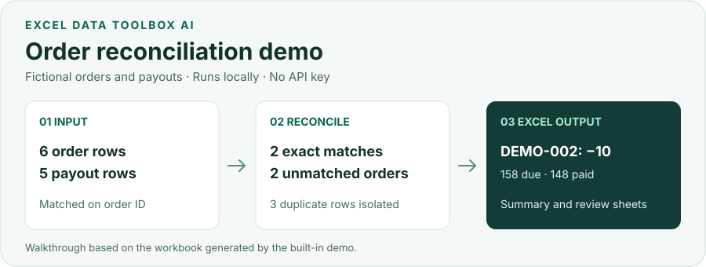

# Excel Data Toolbox AI

Reconcile orders and payouts in Excel on your computer. Match order IDs, flag amount differences and duplicates, and export the evidence for review. The same workspace also cleans, joins, and analyzes spreadsheets.

English | [简体中文](README_ZH.md)

[](https://github.com/yishengliuname/excel-data-toolbox-ai/actions/workflows/ci.yml)
[](https://github.com/yishengliuname/excel-data-toolbox-ai/actions/workflows/codeql.yml)
[](LICENSE)
[](https://www.python.org/downloads/)

**[Download for Windows](https://github.com/yishengliuname/excel-data-toolbox-ai/releases/latest) · [See the demo result](docs/DEMO.md) · [Help improve the project](#contributing)**



### Try an order reconciliation

1. Extract the Windows ZIP and run `BiaogeKuaichuAI.exe`.
2. Choose **试用电商订单对账** (Try order reconciliation). The app creates two fictional tables and reconciles them locally without an API key.
3. Review the exceptions and download the Excel workbook. The sample includes a payout that is 10 currency units short, one unmatched order on each side, and three rows held out because an order ID is duplicated.

The release includes a downloadable `Synthetic-Order-Reconciliation.xlsx` produced by the packaged app. You can also [read the expected results in your browser](docs/DEMO.md).

## What it does

- Clean messy Excel and CSV data.
- Merge, match, and reconcile business tables.
- Analyze sales, finance, inventory, and operational data.
- Generate native Excel charts and management-ready reports.
- Validate outputs without overwriting the original workbook.

## Why not just let an LLM edit Excel directly?

| LLM-only workflow | Excel Data Toolbox AI |
|---|---|
| Model guesses operations | AI creates a structured plan |
| Model may modify data directly | A local whitelist validates operations |
| Hard to audit | Execution and validation are traceable |
| Calculations may be hallucinated | Deterministic Python performs calculations |
| The original workbook may change | Source files remain untouched |

The model interprets the request; it does not receive arbitrary code or file-system access. Ambiguous fields, unsafe parameters, and missing evidence are stopped or marked for review before delivery.

## Quick start

### Windows release

For the shortest setup, open [Releases](https://github.com/yishengliuname/excel-data-toolbox-ai/releases), download `Excel-Data-Toolbox-AI-Windows-x64.zip`, extract it, and run `BiaogeKuaichuAI.exe`.

The Windows package includes its runtime. To use the built-in order demo, choose **试用电商订单对账** after launch.

### Run from source

Python 3.11 or newer is required.

Windows PowerShell:

```powershell
git clone https://github.com/yishengliuname/excel-data-toolbox-ai.git
cd excel-data-toolbox-ai
python -m venv .venv
.\.venv\Scripts\Activate.ps1
python -m pip install -e ".[automation]"
python -m excel_data_toolbox.server
```

Linux or macOS:

```bash
git clone https://github.com/yishengliuname/excel-data-toolbox-ai.git
cd excel-data-toolbox-ai
python3 -m venv .venv
source .venv/bin/activate
python -m pip install -e '.[automation]'
python -m excel_data_toolbox.server
```

Open `http://127.0.0.1:8501/`. For the sales example, select **加载演示数据** (Load demo data), then **执行 AI 命令** (Run command) to run the pre-filled request. Both examples use fictional data. [Demo walkthrough](docs/DEMO.md)

## Architecture

```text
Natural-language request
          ↓
Intent and domain planning
          ↓
Safe parameter validation
          ↓
Deterministic local execution
          ↓
Output validation
          ↓
Excel workbook or report
```

Understanding and execution are deliberately separated. The optional model produces a constrained plan; local Python validates the plan, performs spreadsheet operations, and reopens exported files for delivery checks.

## Key capabilities

- Excel data cleaning, standardization, deduplication, merging, matching, splitting, and masking.
- Tolerance-aware reconciliation with duplicate-key isolation and manual-review candidates.
- Adaptive analysis based on the request, workbook structure, field semantics, and available evidence.
- Native Excel tables, formatting, charts, management summaries, risk lists, and action plans.
- Formula-injection protection, per-task storage, undo/redo, and output re-open validation.
- Reusable recipes, data-quality rules, processing lineage, and auditable delivery notes.

For unfamiliar workbooks, **通用规则分析** (business-rule review) lets you confirm status filters, dates, duplicate keys, units, and custom metrics, then reuse a customer-scoped local profile. See the [rule workflow and boundaries](docs/BUSINESS_RULE_WORKFLOW.md); it does not automatically resolve arbitrary business policies.

The unified UI supports [bounded background delivery](docs/AUTONOMOUS_DELIVERY.md): submit a goal, follow progress, reload to retrieve the result, and download the actual workbook. Unconfirmed rules and partial conclusions remain explicit; this is not an agent that can perform every business task.

## Advanced capabilities

These capabilities are available when the workbook and installed dependencies provide enough evidence:

- Finance: receivables aging, budget variance, cash flow, ratios, and journal-entry checks.
- Operations: sales, inventory, HR, e-commerce, restaurant, and manufacturing analysis packs.
- Analytics: pivots, trends, contribution, anomalies, correlations, regression, and RFM segmentation.
- Files and data: PDF table extraction, image OCR, DuckDB summaries, and read-only SQLite/ODBC queries.
- Engineering handoffs: statically scanned VBA packages and Power BI model/DAX/PBIP artifacts.

Power BI publishing still requires valid Microsoft tenant, license, service-principal, and workspace permissions. OCR requires a compatible Tesseract installation. Subjective approvals and unsupported formats remain explicit human-review boundaries.

## Privacy and safety

- The server binds to `127.0.0.1` by default.
- Original workbooks are not overwritten.
- Each task has isolated input, output, audit, and review storage.
- Formula injection, unsafe SQL, dangerous VBA, resource limits, and output integrity are checked locally.
- Customer data, generated outputs, logs, databases, and `.env` files are excluded from the repository.
- Secrets are read server-side and are not written to plans, workbooks, or operation logs.
- Without an AI provider, no model request is made.

When an optional provider is enabled, the default planning request contains the user's instruction and selected table schema catalogue, not complete cell contents. Read [Privacy](docs/PRIVACY.md) and [Security](SECURITY.md) before using private business data.

## AI provider configuration (optional)

DeepSeek is currently supported as an optional planning provider. Copy `.env.example` to `.env` only if you want to enable it:

```text
DEEPSEEK_API_KEY=
DEEPSEEK_MODEL=deepseek-v4-flash
```

Restart the local app after configuration. Never commit `.env`, paste an active key into an issue, or include customer data in a public reproduction.

## Development

```bash
python -m pip install -e '.[automation,dev]'
python scripts/check_secrets.py
python -m ruff check . --select E9,F63,F7,F82
python scripts/check_docs_links.py
python -m pytest -q
python -m build
```

Useful project guides:

- [Architecture](docs/ARCHITECTURE.md)
- [Repeatable demo](docs/DEMO.md)
- [Maintainer release guide](docs/GITHUB_RELEASE.md)
- [Domain-pack guide](docs/ADDING_DOMAIN_PACK.md)
- [Roadmap](docs/ROADMAP.md)

## Contributing

**Please help make this project easier to use and more reliable.** If you reconcile spreadsheets for work, try the demo once and tell us where you got stuck, which result was hard to interpret, or which check you still had to do by hand. A short report is a useful contribution, even if you have never opened a pull request. [Share feedback or report a bug](https://github.com/yishengliuname/excel-data-toolbox-ai/issues/new/choose)

If you would like to contribute code, start with a small documentation, testing, accessibility, or packaging improvement. An example with fictional rows and a clear expected result helps us reproduce a problem safely. Thank you for giving it a try. [Contribution guide](CONTRIBUTING.md) · [Starter tasks](docs/GOOD_FIRST_ISSUES.md)

If it saves you time on Excel work, a ⭐ helps more people find the project.

## Roadmap

The current focus is reliability, packaging, cross-platform verification, and contributor experience—not adding a new customer-specific branch for every workbook. See the public [roadmap](docs/ROADMAP.md).

## License

Released under the [Apache License 2.0](LICENSE). You may use, modify, and commercialize the project subject to the license and notice requirements. The software is provided as-is and is not accounting, tax, legal, audit, HR, or investment advice.
