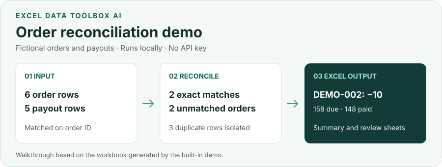

# Excel Data Toolbox AI（表格快处 AI）

在本机核对 Excel 订单与平台结算单，找出金额差异、重复单号和未匹配记录，再导出带明细的 Excel 供复核。也支持表格清洗、合并和分析。

[English](README.md) | 简体中文

[](https://github.com/yishengliuname/excel-data-toolbox-ai/actions/workflows/ci.yml)
[](https://github.com/yishengliuname/excel-data-toolbox-ai/actions/workflows/codeql.yml)
[](LICENSE)
[](https://www.python.org/downloads/)

**[下载 Windows 版](https://github.com/yishengliuname/excel-data-toolbox-ai/releases/latest) · [直接看演示结果](docs/DEMO.md) · [一起完善项目](#一起完善项目)**



### 试一次电商订单对账

1. 下载并解压 Windows 安装包，运行 `BiaogeKuaichuAI.exe`。
2. 点击 **试用电商订单对账**。程序在本机生成两张虚构表并完成对账，无需 API Key。
3. 查看异常并下载 Excel。样例包含一笔少结 10 元的订单、两张表各一笔未匹配记录，以及因订单号重复而隔离的 3 行。

发布页提供由打包程序实际生成的 `Synthetic-Order-Reconciliation.xlsx`。也可以直接在浏览器里查看 [输入和预期结果](docs/DEMO.md)。

## 它能做什么

- 清洗杂乱的 Excel 和 CSV 数据。
- 合并、匹配和对账业务表。
- 分析销售、财务、库存和经营数据。
- 生成原生 Excel 图表和管理层可读报告。
- 不覆盖原始工作簿，并对导出结果自动验收。

## 为什么不让大模型直接修改 Excel？

| 仅由大模型处理 | Excel Data Toolbox AI |
|---|---|
| 模型猜测操作 | AI 生成结构化计划 |
| 模型可能直接改数据 | 本地白名单先校验操作 |
| 难以审计 | 执行过程和验收结果可追踪 |
| 计算可能被“编出来” | 确定性 Python 代码执行计算 |
| 原文件可能被改变 | 原始文件保持不变 |

模型只负责理解需求，不会获得任意代码或文件系统权限。字段歧义、危险参数和证据缺口会在交付前被拦截或标记为人工核验。

## 快速开始

### Windows 发布版

进入 [Releases](https://github.com/yishengliuname/excel-data-toolbox-ai/releases)，下载 `Excel-Data-Toolbox-AI-Windows-x64.zip`，解压后运行 `BiaogeKuaichuAI.exe`。

Windows 发布包包含运行环境。打开程序后即可点击 **试用电商订单对账**。

### 从源码运行

需要 Python 3.11 或更高版本。

Windows PowerShell：

```powershell
git clone https://github.com/yishengliuname/excel-data-toolbox-ai.git
cd excel-data-toolbox-ai
python -m venv .venv
.\.venv\Scripts\Activate.ps1
python -m pip install -e ".[automation]"
python -m excel_data_toolbox.server
```

Linux 或 macOS：

```bash
git clone https://github.com/yishengliuname/excel-data-toolbox-ai.git
cd excel-data-toolbox-ai
python3 -m venv .venv
source .venv/bin/activate
python -m pip install -e '.[automation]'
python -m excel_data_toolbox.server
```

打开 `http://127.0.0.1:8501/` 即可试用。想体验销售分析，可以点击 **加载演示数据**，再点击 **执行 AI 命令**，使用预填的销售报表命令。[演示步骤](docs/DEMO.md)

## 架构

```text
自然语言需求
      ↓
意图与领域规划
      ↓
安全参数校验
      ↓
本地确定性执行
      ↓
输出自动验收
      ↓
Excel 工作簿或报告
```

理解与执行相互分离：可选模型只产生受约束的计划，本地 Python 负责校验、计算和导出后重开验收。

## 核心能力

- Excel 清洗、标准化、去重、合并、匹配、拆分和脱敏。
- 支持金额与日期容差、重复键隔离和待核验候选的对账。
- 根据用户需求、工作簿结构、字段语义和现有证据生成自适应分析。
- 生成原生 Excel 表格、格式、图表、管理摘要、风险清单和行动方案。
- 提供公式注入防护、一单一目录、撤销/重做和导出重开验收。
- 支持可复用方案、数据质量规则、处理血缘和可审计交付说明。

陌生数据可以使用“通用规则分析”，确认状态、日期、去重键、单位与自定义指标，再保存为该客户的本地配置复用。详见[规则流程与边界](docs/BUSINESS_RULE_WORKFLOW.md)；系统不会自动猜测任意业务口径。

统一界面支持[有边界的后台自主交付](docs/AUTONOMOUS_DELIVERY.md)：提交目标后查看进度，刷新后找回结果并下载实际工作簿。未确认规则与部分结论会明确披露，不代表能够自动完成所有经营任务。

## 高级能力

以下能力只有在数据和本地依赖满足要求时才会启用：

- 财务：应收账龄、预算差异、现金流、财务比率和凭证检查。
- 经营：销售、库存、人力、电商、餐饮和制造业分析能力包。
- 分析：透视、趋势、贡献、异常、相关、回归和 RFM 分群。
- 文件与数据：PDF 表格提取、图片 OCR、DuckDB 汇总和 SQLite/ODBC 只读查询。
- 工程交付：经过静态扫描的 VBA 包，以及 Power BI 模型、DAX、PBIP 工程文件。

Power BI 云发布仍需要有效的 Microsoft 租户、许可证、服务主体和工作区权限；OCR 需要兼容的 Tesseract；主观审批和不受支持的格式会进入人工核验。

## 隐私与安全

- 服务默认只监听 `127.0.0.1`。
- 不覆盖原始工作簿。
- 每个任务拥有独立的输入、输出、审计和核验目录。
- 本地检查公式注入、危险 SQL/VBA、资源上限和导出完整性。
- 客户数据、输出、日志、数据库和 `.env` 默认禁止进入仓库。
- 密钥只在服务端读取，不写入计划、工作簿或操作日志。
- 不启用 AI 服务时不会发送模型请求。

启用可选模型时，默认发送需求和所选表的结构目录，不发送完整单元格内容。处理私人业务数据前请阅读 [隐私说明](docs/PRIVACY.md) 和 [安全政策](SECURITY.md)。

## AI 服务配置（可选）

目前 DeepSeek 是可选的需求规划服务。只有需要启用时才复制 `.env.example` 为 `.env`：

```text
DEEPSEEK_API_KEY=
DEEPSEEK_MODEL=deepseek-v4-flash
```

保存后重启本地程序。不要提交 `.env`，不要在公开 Issue 中粘贴有效密钥，也不要上传客户工作簿。

## 一起完善项目

这个项目由个人维护，最需要的是不同工作场景里的真实反馈。诚恳邀请做财务、电商运营或日常表格工作的朋友试一次对账演示，告诉我哪一步卡住、哪个结果不好理解，或者哪项核对还得自己做。即使只留一句话，也能帮助我们改进。欢迎用中文或英文。 [提交试用反馈](https://github.com/yishengliuname/excel-data-toolbox-ai/issues/new/choose)

如果愿意动手，欢迎从文档、测试、可访问性或打包的小改动开始。用几行虚构数据说明问题和预期结果，就能帮助我们安全地复现。谢谢你愿意一起完善。 [贡献指南](CONTRIBUTING.md) · [适合上手的任务](docs/GOOD_FIRST_ISSUES.md)

如果项目确实帮你减少了 Excel 重复工作，欢迎点一个 ⭐，让更多人发现它。

## 开发

```bash
python -m pip install -e '.[automation,dev]'
python scripts/check_secrets.py
python -m ruff check . --select E9,F63,F7,F82
python scripts/check_docs_links.py
python -m pytest -q
python -m build
```

第一次贡献请从 [Your first contribution](CONTRIBUTING.md#your-first-contribution) 和准备好的 [good first issues](docs/GOOD_FIRST_ISSUES.md) 开始。架构、演示、发布、领域扩展和路线图分别见：

- [架构说明](docs/ARCHITECTURE.md)
- [可重复 Demo](docs/DEMO.md)
- [维护者发布指南](docs/GITHUB_RELEASE.md)
- [领域能力包指南](docs/ADDING_DOMAIN_PACK.md)
- [路线图](docs/ROADMAP.md)

安全漏洞请按照 [SECURITY.md](SECURITY.md) 私密报告。任何公开 Issue 和 PR 都不能包含客户数据或有效凭据。

## 许可证

项目采用 [Apache License 2.0](LICENSE)。可以使用、修改和商业化，但必须遵守许可证与 NOTICE 要求。本软件按现状提供，不构成财务、税务、法律、审计、人事或投资建议。
